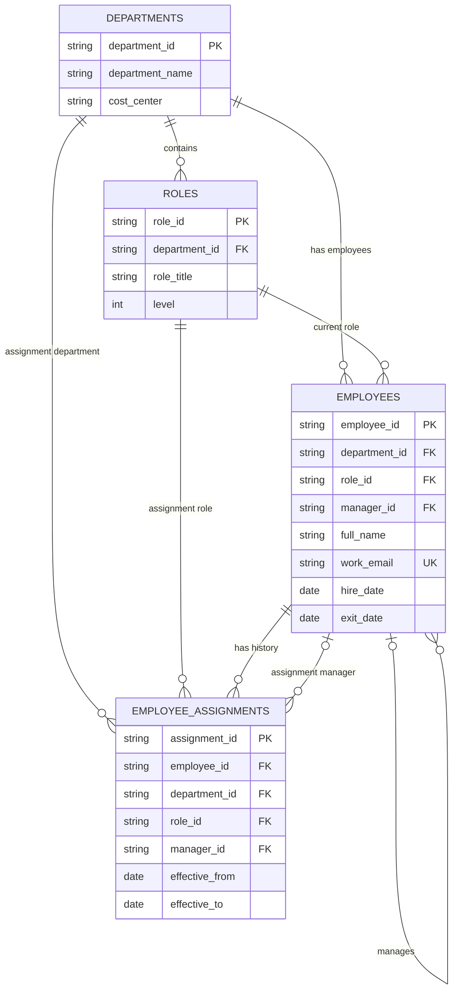

# LedgerForge — Database ER Diagram

## Core HR Data Model

This diagram represents the four core tables used for
employee information, roles, departments, and assignment history.

## Database Rules

- Each department can contain multiple roles.
- Each employee belongs to one current department and role.
- An employee may have another employee as their manager.
- One employee can have multiple assignment-history records.
- Every work_email must be unique.
- exit_date cannot be earlier than hire_date.
- effective_to cannot be earlier than effective_from.
- A NULL exit_date or effective_to is allowed.
- Employee searches have indexes on department_id,
  manager_id, full_name, and employment_status.

## Migration

Initial database migration:
`faca27f3c8a6_create_core_hr_tables.py`

The migration supports both upgrade and downgrade.
